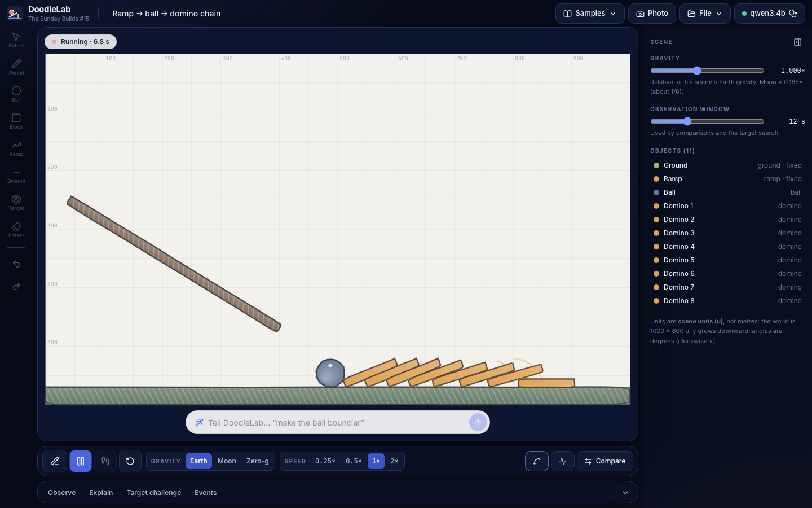
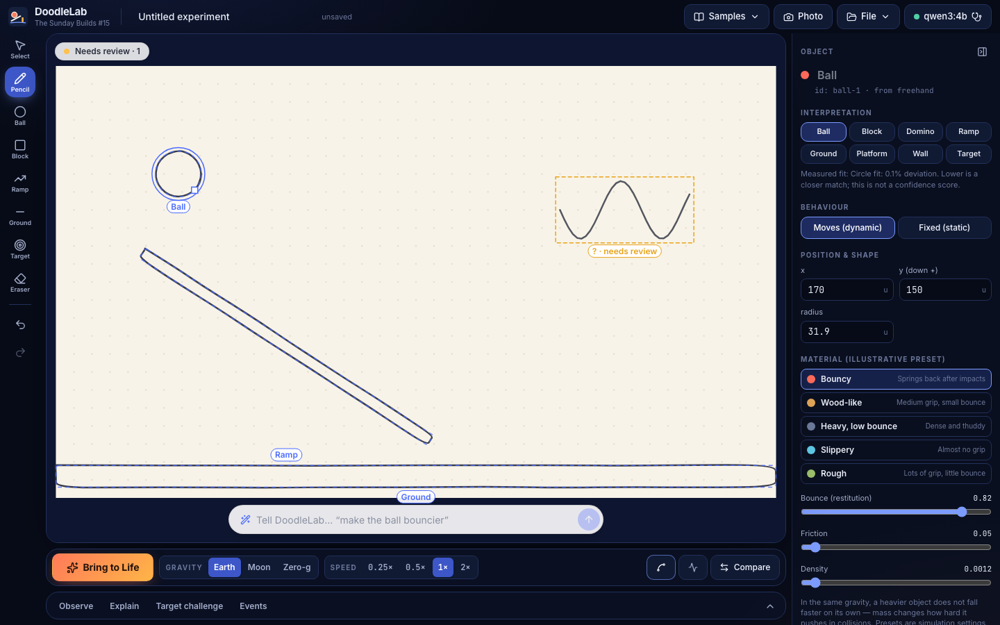
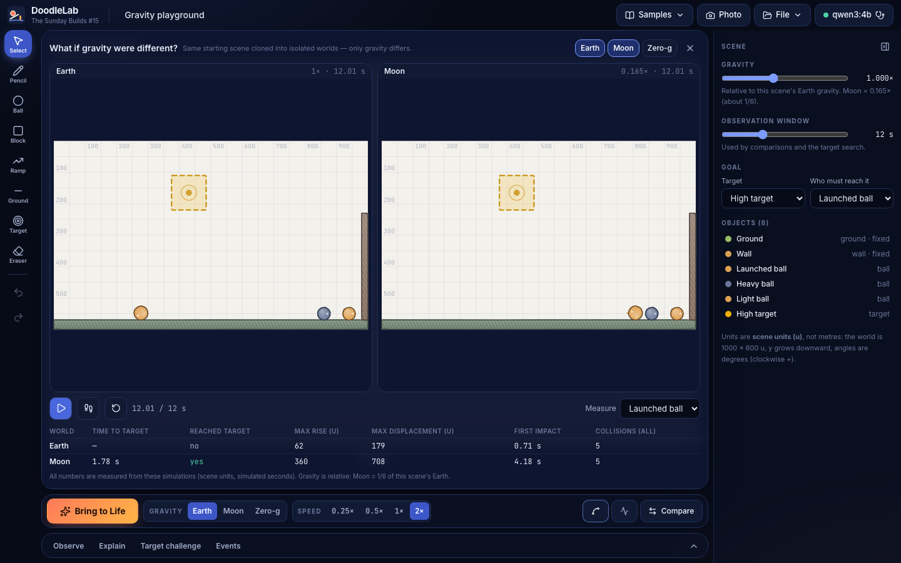
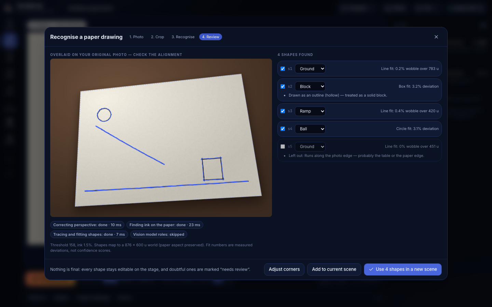
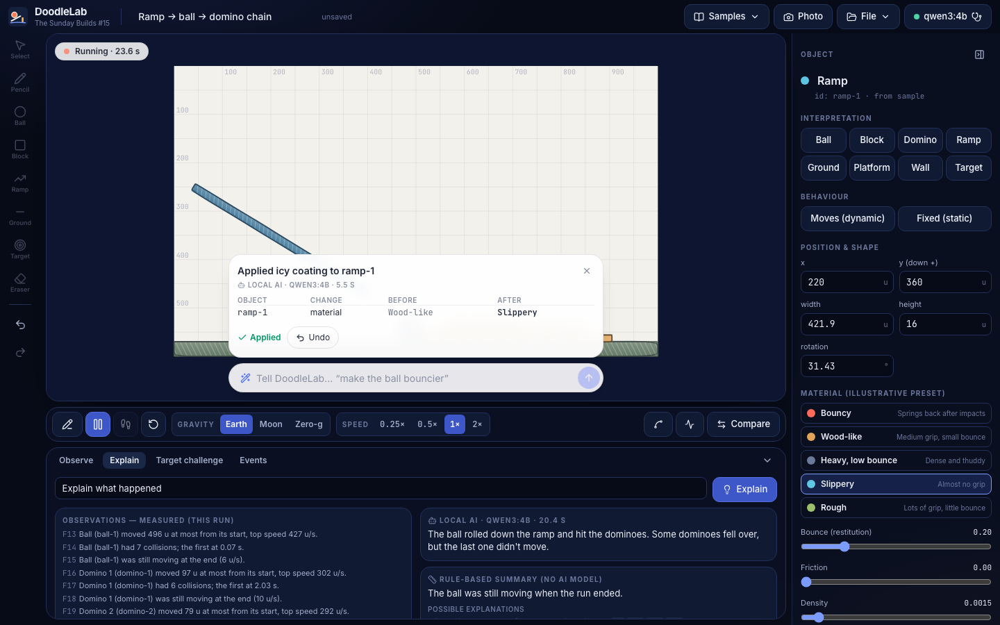
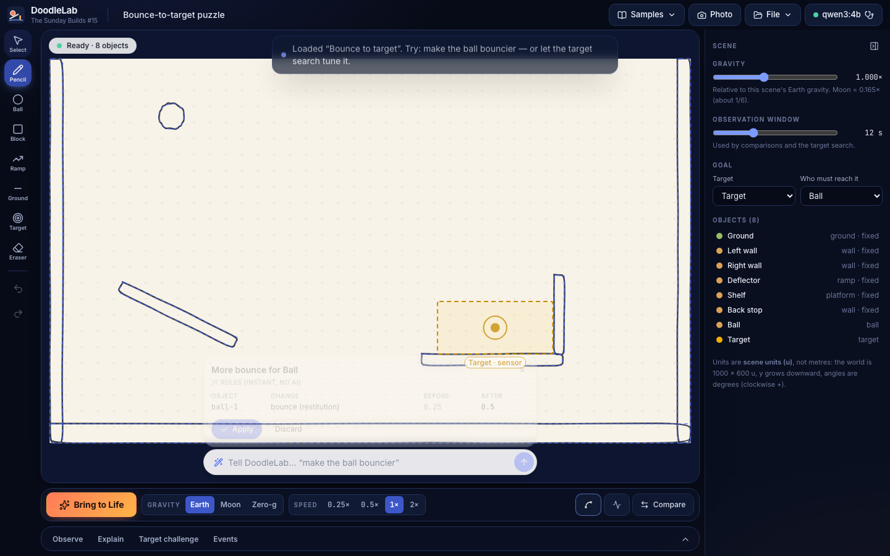
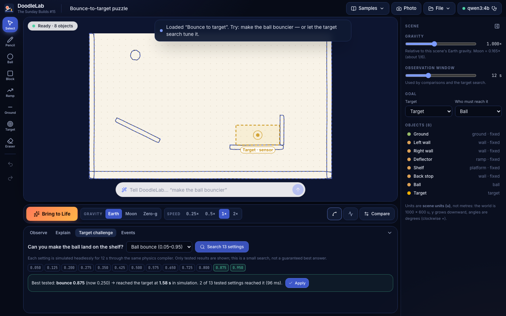

<div align="center">


# DoodleLab

### Draw it. Bring it to life.

Turn simple drawings into **editable, interactive 2D physics experiments**. Draw a ball, a ramp and some
ground (or photograph a paper sketch), check what DoodleLab recognised, press **Bring to Life**, and
your own doodle starts rolling, bouncing and knocking things over. Then change the gravity, compare
Earth and Moon side by side, and ask *why* it happened.

**No cloud. No API key. No account.** Physics and drawing recognition are deterministic code on your
machine; a local Ollama model only helps with explanations and edit proposals.

[-00a07d?style=flat-square)](#local-ai-and-what-it-is-allowed-to-do)
[](#physics)
[](#validation-results)
[](#architecture)
[](LICENSE)

*The Sunday Builds #15 — Solving Real Problems using Free AI, every Sunday.*

</div>

---

<div align="center">

<p><em>The domino chain, alive. Every shape keeps its hand-drawn outline; colour shows its material.</em></p>
</div>

## What it is (and isn't)

DoodleLab is a playful **physics sketchbook** for a parent and child at the kitchen table, with enough
depth (telemetry, side-by-side worlds, a bounded parameter search) to interest an engineer.

It is **not** a general image animator, it does not understand arbitrary drawings, and it is not an
engineering-grade simulator. Units are **scene units (u)**, not metres; materials are **illustrative
presets**, not measured real materials.

### Supported drawing vocabulary

| You draw… | DoodleLab makes… | Default |
| --- | --- | --- |
| a circle | **ball** | moves, bouncy |
| a box | **block** (tall thin box → **domino**) | moves, wood-like |
| a straight sloped line | **ramp** | fixed |
| a long flat line near the bottom | **ground** | fixed |
| a flat line | **platform** | fixed |
| a vertical line | **wall** | fixed |
| two concentric rings (photos) / the Target tool | **target zone** — a sensor, things pass through it | fixed |

Anything else (open curves, triangles, scribbles) is **not guessed**: it is marked *Needs review* and you
choose what it is, or leave it out.

## The experience

1. **Draw** on the paper with the pencil (or the Ball / Block / Ramp / Ground / Target tools), **or** use
   **Photo** to upload / capture a paper drawing.
2. **See** recognised outlines and labels. Doubtful guesses are amber and say *why* (e.g. "Between a circle
   and a box", "Oval shape"), with the measured fit deviation — never a made-up confidence %.
3. **Correct** any interpretation in the inspector (role, static/dynamic, material, size, position).
4. **Bring to Life** — the outlines are traced, colour and shading fill in, the paper fades, and only then
   does physics start (≈1.1 s; ≈0.16 s with *reduce motion*).
5. **Experiment** — play/pause/step/reset, speed, gravity presets, drag and throw objects, trails and
   velocity arrows, collision and target events.
6. **Compare** Earth / Moon / Zero-g side by side from the same starting scene, with a measured results table.
7. **Ask why** — measured observations, a rule-based summary and (optionally) a local-AI explanation that
   is checked against the measurements.

| | |
|---|---|
|  <br>*An open curve is not guessed — it waits for you.* |  <br>*Same scene, two isolated worlds. Only gravity differs.* |
|  <br>*Photo recognition, overlaid on the original photo to check alignment.* |  <br>*Observations (measured) vs. explanations (AI, cited, number-checked).* |
|  <br>*Every edit is a proposal: exact IDs, before → after, Apply, Undo.* |  <br>*Target challenge: only tested settings are reported.* |

## Quick start (macOS)

```bash
./run.sh
```

That's it. The launcher:

- checks Node.js ≥ 20.9 and installs npm dependencies on first run;
- reuses an Ollama that is already running, or starts `ollama serve` if Ollama is installed;
- **asks before downloading any model** (`qwen3:4b` ≈ 2.5 GB text model; optional `qwen2.5vl:3b`
  ≈ 3.2 GB vision model) — non-interactive runs never download;
- builds once, starts on **http://localhost:3015** and opens your browser;
- if port 3015 is taken by another app it picks the next free port; if DoodleLab is already running there it
  just opens it.

Options: `./run.sh --dev` (hot reload), `PORT=3020 ./run.sh`, `DOODLELAB_NO_OPEN=1 ./run.sh`.

### Manual path

```bash
npm install
npm run build && npm start        # http://localhost:3015
# or: npm run dev
ollama pull qwen3:4b              # optional: copilot + explanations
ollama pull qwen2.5vl:3b          # optional: role hints for photos
```

Requirements: Node.js 20.9+, a modern Chromium/Safari/Firefox. Ollama is optional.
The first `npm install` and any model downloads need internet; after that everything runs offline.

**Before a demo**, open the status button (top right) → *Demo readiness*. It actually runs every check:
server + dependencies, a physics self-test, all three samples (simulated and their outcomes verified),
browser storage, Ollama, the selected model, the optional vision model and (on request) the camera.
Nothing is marked passed without being tested.

## Architecture

Four layers, kept strictly apart:

```
 1 Acquisition            2 Recognition                    3 Compile + simulate          4 AI (optional)
 ─────────────            ─────────────                    ───────────────────           ──────────────
 pencil strokes  ──────►  stroke fitter (circle/box/line)  ┐
 tools (ball, ramp…) ──►  exact shapes                     ├─► SceneSpec ─► validator ─► Matter.js world ─► telemetry ─► facts
 photo / camera  ──────►  perspective fix → threshold →    ┘   (Zod, v1)    (bounds,      (fixed 1/120 s     (measured)    │
                          components → contours → same          ▲            overlaps,     step, reset =                    ▼
                          stroke fitter  (+ optional VLM        │            references)   recompile)          explanation (cited,
                          role HINTS only)                      │                                              number-checked)
                                                                └──── ScenePatch (allowlisted ops, exact IDs) ◄── copilot: rules first,
                                                                      preview → Apply → Undo                     local LLM second
```

- **One contract — `SceneSpec`** ([lib/scene/spec.ts](lib/scene/spec.ts)): versioned, Zod-validated, shared by
  drawing, photo recognition, samples, AI proposals, persistence and the compiler. Stable IDs
  (`ball-1`), shape + geometry, centre position, `rotationDeg`, static flag, named material preset +
  bounded overrides, optional constraints (pin, rope), gravity, observation window, target goal,
  provenance (tool / freehand / image / sample / copilot / import, with measured fit deviation).
- **Scene coordinates:** world is `width × height` scene units (default 1000 × 600; photos keep the paper's
  aspect, e.g. 876 × 600). Origin top-left, **+Y is down**, angles in **degrees**, clockwise-positive.
  Radians exist only inside the compiler. Recognition produces normalized [0,1] coordinates, converted by
  explicit, invertible transforms ([lib/geometry/transforms.ts](lib/geometry/transforms.ts),
  [lib/vision/pipeline.ts](lib/vision/pipeline.ts)).
- **Validation** ([lib/scene/validate.ts](lib/scene/validate.ts)): finite, bounded numbers; ≤ 60 objects;
  valid unique IDs and references; out-of-bounds geometry; initial penetrations (via Matter's own collision
  test); thin statics; nothing-to-land-on. Major problems are **never silently repaired** — the inspector
  shows the problem and a *proposed* fix button.
- **State:** the authored scene lives in a Zustand store with undo/redo; the live world lives in
  `LabController` outside React ([lib/state/controller.ts](lib/state/controller.ts)) with one engine and one
  animation loop. Switching tabs or panels never touches it.
- **Rendering:** custom Canvas2D ([lib/render/renderer.ts](lib/render/renderer.ts)). Each object carries its
  original hand-drawn outline in its local frame, so *your* doodle is what moves.

### Physics

- Matter.js 0.20, **fixed 1/120 s step**, bounded accumulator (≤ 8 steps per frame). Speed settings
  (0.25×–2×) change how many fixed steps run, never the step size — outcomes are identical at every speed.
- **Reset** disposes the engine (bodies, constraints, listeners) and recompiles the authored spec, restoring
  positions, velocities, constraints and gravity. Tests prove no engines or listeners pile up.
- **Fast objects:** velocity clamp (1900 u/s ≈ 16 u per step) plus a warning for statics thinner than 10 u.
  A ball launched at the clamp onto a 16 u ramp is tested not to tunnel. Collision detection is *not* claimed
  to be perfect.
- **Telemetry** ([lib/physics/telemetry.ts](lib/physics/telemetry.ts)): per-body peak height, max rise,
  max displacement, path length, speeds, collisions (resting contacts excluded), first impact, rest time,
  leaving the world; target entries; capped event log. All in scene units and simulated seconds.
- **Gravity** is relative to the scene's Earth: Earth 1×, Moon 0.165× (≈1/6), Zero-g 0. In the same gravity a
  heavier object does not fall faster — tested: heavy and light balls land within one step of each other.

### Local AI and what it is allowed to do

| Task | How | Guardrails |
| --- | --- | --- |
| Native drawing recognition | deterministic geometry | no model ever |
| Physics, telemetry, target search | deterministic | no model ever |
| Copilot edits | **rules first** (instant), local LLM only for the rest | output = allowlisted `ScenePatch` ops on exact IDs, schema-validated, re-validated against the *current* scene, shown as before/after, needs **Apply**, undoable; stale proposals are refused |
| Explanations | facts from telemetry → rule-based summary always; LLM optional | LLM sees only numbered facts, must cite them; sentences with numbers that weren't measured are removed and reported; labelled "Local AI" vs "Rule-based summary (no AI model)" |
| Photo double-check | optional local vision model, **one small crop per found shape** | answers only a coarse class (round / rings / box / line / text-or-scribble); a deterministic rule compares it with the geometry; disagreements become *Needs review* with a one-click suggestion — never geometry, never silent role changes |

The AI never writes or runs code, never touches the simulation loop and never reports measurements.
Requests are bounded (45–90 s), cancellable, and the physics keeps running while they think.
Model handling: real installed models and capabilities come from `/api/tags` + `/api/show`; cloud models
are flagged and never auto-selected; `qwen3` thinking models get `think:false` + a JSON schema `format`.

## Photo / paper recognition

Upload a PNG/JPEG or capture from this computer's camera → drag four corners onto the paper (placed
automatically when the paper stands out from the table) → **Recognise**. Stages are real and timed:
perspective correction → ink threshold (lighting-flattened Otsu) → connected components + outer contours →
**the same stroke fitter as freehand drawing** → optional vision double-check (one crop per shape, coarse class
only). Concentric rings become a target; marks along the photo edge
and specks are left out with a stated reason. Results are overlaid on the **original** photo for alignment,
stay editable, and are never hard-coded.

Tips shown in the app: dark pen on plain light paper, one shape per stroke group, leave a finger-width gap
between shapes (touching shapes merge into one blob), avoid shadows.

Three **synthetic** paper-photo fixtures live in [public/fixtures](public/fixtures) (rendered pencil drawings
photographed in a virtual scene with perspective, uneven light, paper grain and JPEG compression by
[scripts/make-fixtures.mjs](scripts/make-fixtures.mjs)). They are labelled as synthetic in the UI and run
through the exact same pipeline. **They are not real camera photos** — see [Remaining gaps](#remaining-gaps).

## The three demo scenes

All three are plain SceneSpecs through the same validator and compiler as your drawings
([lib/scene/samples.ts](lib/scene/samples.ts)); their outcomes are re-verified by simulation in the tests and
in the readiness check.

1. **Domino chain** — a heavy ball leaves a ramp and strikes eight dominoes high; all eight topple by ≈4.7 s,
   and still do with the ball's start nudged ±8 u.
2. **Gravity playground** — one launched ball (identical launch) plus a heavy and a light ball dropped together.
   Earth: the launched ball misses the high target. Moon: it reaches it at 1.78 s. Heavy and light land together.
3. **Bounce to target** — a ball drops onto a deflector. Wood-like: misses the shelf. Make it bouncier (or let
   the target search find a bounce): it lands in the target at ≈1.5 s. Robust to ±12 u / ±2° nudges.

## 90-second live demo runbook

Before going on stage: `./run.sh`, open **Demo readiness**, confirm all green (Ollama/model optional),
then **File → New blank scene**.

| Time | Do | Say |
| --- | --- | --- |
| 0:00 | Pencil: draw a circle top-left, a sloped line under it, a long line along the bottom. | "I just draw." |
| 0:15 | Point at the outlines + labels (Ball, Ramp, Ground). Draw a squiggle → amber *Needs review*; click **Remove** in the inspector. | "It shows what it understood — and it never guesses on the squiggle." |
| 0:25 | **Bring to Life**. | "Same doodle — now it's physics." |
| 0:35 | Grab the ball and throw it. **Reset**. | "Reset is exact, every time." |
| 0:45 | **Samples → Domino chain → Bring to Life**. | Chain reaction. |
| 0:55 | Type *"make the ball bouncier"* → proposal → **Apply** → Reset → watch it bounce. **Undo**. | "Every change is a proposal I approve." |
| 1:05 | **Samples → Gravity playground → Compare** → Play (2×). | "Same launch, Earth vs Moon — the Moon one reaches the target; numbers are measured." |
| 1:20 | **Explain** tab → *Explain what happened*. | "Observations are measured; the explanation cites them." |
| 1:30 | End on the live chain. | "Draw it. Bring it to life." |

**Backup demo (no drawing, no AI, same physics pipeline):** if the trackpad or Ollama misbehaves, use only
the three samples: Domino chain → Bring to Life; Bounce to target → Target challenge → *Search 13 settings* →
Apply → Bring to Life; Gravity playground → Compare. Explanations still work as the clearly labelled
rule-based summary. If Ollama is down, the copilot's built-in commands (*make the ball bouncier*,
*make gravity weaker*, *add three dominoes after the ramp*, *raise the selected ramp slightly*,
*reset the experiment*) still work offline.

## Copilot vocabulary (instant, no model)

`make this ball bouncier` · `less bouncy` · `make gravity weaker / stronger` · `moon gravity` · `zero gravity` ·
`add three dominoes after the ramp` · `add a ball` · `raise / lower the selected ramp slightly` · `make the ramp steeper` ·
`move the block left 40` · `make the ramp slippery / rough` · `make it heavier` · `make the block static` ·
`remove the box` · `reset the experiment` · `play` / `pause` · `compare` · `explain why the ball stopped`.
If "this" is ambiguous, it asks which object. Anything else goes to the local model (if available) as a
proposal you can apply or discard.

## Persistence & export

- **Autosave** of the current scene and **File → Save to this browser** (versioned project files in
  `localStorage`; every load re-validates). Browser storage is per-browser and ≈5 MB; large photos are not
  stored (you're told).
- **Export / Import scene JSON** — the SceneSpec itself, validated on import.
- **Export PNG with notes** — the current scene (live pose if running) plus a measured-notes footer.
- No GIF/video export: it isn't implemented, so there is no button for it.

## Privacy & offline

Everything runs on your machine. Photos are processed in the browser and only the rectified image goes to
your local Ollama (if you enabled a vision model). No analytics, no CDN — fonts, icons and scripts are bundled
locally. After installation DoodleLab works with the network off (AI features need the local Ollama only).

## Validation results

Measured on the target machine: **MacBook Air M4, 24 GB, macOS 15.5**, Node 25.9, Ollama 0.24.0,
`qwen3:4b` + `qwen2.5vl:3b`, Chromium (Playwright headless shell 1243).

| Check | Result |
| --- | --- |
| `npm run typecheck` / `npm run lint` | clean |
| `npm run build` (Next.js 16.4, production) | ✓ |
| Unit tests (`npm test`, Vitest) | **99 passed** — SceneSpec/ScenePatch validation, transforms (normalized↔world↔screen, homography, photo↔rectified), reset restoring state, listener/engine disposal, determinism, speed independence, isolated comparison worlds, gravity presets + Moon/Earth fall-time ratio, mass independence, target sensors, tunnelling, collision honesty, stroke fitting, image pipeline (incl. perspective + auto paper detection), bad model JSON / timeout / cancellation / missing model / Ollama offline, stale AI responses, grounding check, copilot vocabulary, target search, save/load round trips |
| Browser tests (Playwright) | **16 passed** (15 in `npm run test:e2e` + 1 booting through `./run.sh`) — draw → review → play → pause → step → reset; domino chain; Earth vs Moon compare; copilot apply + undo; target search → apply → reaches target; missing Ollama + missing model; photo upload → review → physics; both other fixtures; replay; 30-body performance; **real `qwen3:4b`** proposal + grounded explanation; **real `qwen2.5vl:3b`** photo double-check; boot via `./run.sh` |
| Physics cost, 30 moving bodies | **0.047 ms** per fixed step (budget 8.3 ms) |
| Browser, 30 moving bodies at 1280×800 | **60.3 fps** average, worst frame 16.8 ms |
| Photo pipeline, per fixture (Node) | 40–55 ms total; paper corners auto-found within ≈5 px; all expected shapes found in all 3 fixtures |
| Local AI (`qwen3:4b`, single runs) | edit proposals 2.1–7.8 s; grounded explanation 19.3 s |
| Vision double-check (`qwen2.5vl:3b`, 3 synthetic fixtures) | **15/16 agree** with geometry; the 1 disagreement is correct (it flags the scribble geometry called a box). ≈1.1–1.3 s per crop warm; 5.6–9.1 s per photo incl. model load. |

Run them yourself:

```bash
npm test
NEXT_DIST_DIR=.next-verify npm run build && npm run test:e2e     # port 3025, won't touch :3015
npx playwright test -c playwright.launcher.config.ts             # boots via ./run.sh
```

E2E needs a Playwright Chromium (`npx playwright install chromium`, one-time download).

### Tested vs untested platforms

- **Tested:** macOS 15.5 on Apple M4 with Chromium (headless, via Playwright); desktop 1440×900 and laptop
  1280×800/760 layouts.
- **Not tested:** Safari, Firefox, Windows, Linux, touch devices (pointer events are used throughout, so touch
  *should* work, but it wasn't tested on a device), real webcams (camera code path exercised only up to the
  permission check).

## Known limitations

- **Recognition:** circles, boxes and straight lines only; no arbitrary polygons or concave shapes. Each
  freehand stroke is fitted on its own (a box drawn as two strokes becomes two lines). In photos, touching
  shapes merge into one blob and need manual correction; text and scribbles are left for review, not read.
- **Vision model:** validated end to end with `qwen2.5vl:3b` on the three *synthetic* fixtures only. A 3B model
  could not reliably map IDs to shapes on the whole sheet or judge line orientation, so it is used per crop for
  coarse classes only (see below). Thin boxes (dominoes) look like lines to it; that is treated as compatible.
- **Fixtures are synthetic**, not phone photos. Real-photo accuracy (glare, lined paper, pencil vs marker)
  is unmeasured.
- **Physics:** rigid 2D bodies only; no rolling resistance model beyond friction/air drag; Matter.js has no
  continuous collision detection — mitigated by a velocity clamp and minimum thickness, not eliminated.
  Results are deterministic for the same build and inputs, not physically calibrated.
- **Units:** scene units and simulated seconds; no metres, newtons or joules are shown — on purpose.
- **Storage:** localStorage only (per browser, ≈5 MB). Use JSON export for anything important.

## Remaining gaps

- Validate photo recognition on real phone photos of paper drawings (add them to `public/fixtures`).
- Measure the vision double-check on real photos (so far: 16 shapes on synthetic fixtures).
- Test on Safari/Firefox and on a touch device.

## Deliberately deferred

- GIF/video export (no half-working button).
- Arbitrary polygon / concave shapes (needs proper decomposition and tests).
- Multi-stroke shape grouping and segmentation of touching shapes in photos.
- Windows launcher (`run.bat`) — not tested, so not shipped.

## Troubleshooting

| Symptom | Fix |
| --- | --- |
| "Ollama offline" in the status button | `ollama serve` (or open the Ollama app). Drawing and physics work without it. |
| "No local text model" | `ollama pull qwen3:4b`, then choose it in *Demo readiness → Local models*. |
| Copilot says the model timed out | First request loads the model (can take 10–20 s); try again. |
| Port 3015 busy | `./run.sh` picks the next free port automatically, or `PORT=3020 ./run.sh`. |
| Photo finds nothing | Darker pen, plainer paper, better light; drag the corners onto the paper. |
| Two shapes became one in a photo | They touch — redraw with a gap, or fix it in the inspector. |
| "Review N items before bringing it to life" | Open the inspector (Scene) and confirm or change each amber item, or *Accept all as shown*. |
| Saved projects vanished | Browser storage was cleared — keep JSON exports for important work. |

## Project layout

```
app/                 page, layout, API routes (/api/ai/{status,patch,explain,vision}, /api/health)
components/          Studio, stage canvas, tool rail, play bar, inspector, tray (observe/explain/challenge/events),
                     copilot, compare view, photo import, readiness + projects dialogs
lib/scene/           SceneSpec, materials, objects, samples, validator, ScenePatch
lib/geometry/        math, stroke fitter, coordinate transforms + homography
lib/physics/         compiler, fixed-step simulation, telemetry, target search, self-tests
lib/vision/          photo pipeline (warp, threshold, components, contours, paper detection)
lib/ai/              Ollama client, prompts + schemas, op conversion
lib/explain/         facts from telemetry, rule-based explanations, grounding check
lib/copilot/         deterministic command parser
lib/state/           stores, controller (live world + loop), persistence, actions
tests/unit/          Vitest suites            tests/e2e/   Playwright suites
scripts/             fixture generator, perf scene      public/fixtures/   synthetic paper photos
```

Built from the [Sunday AI template](https://github.com/KrishnaRode/sunday-ai-template) philosophy, adapted
from a single centred page to a canvas-first studio. MIT licensed.
